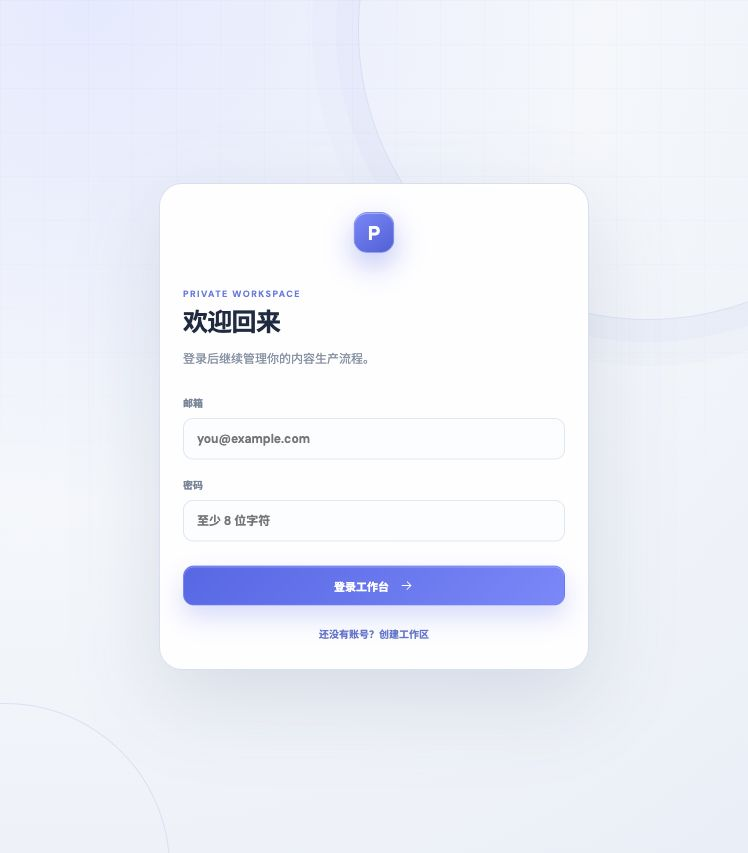
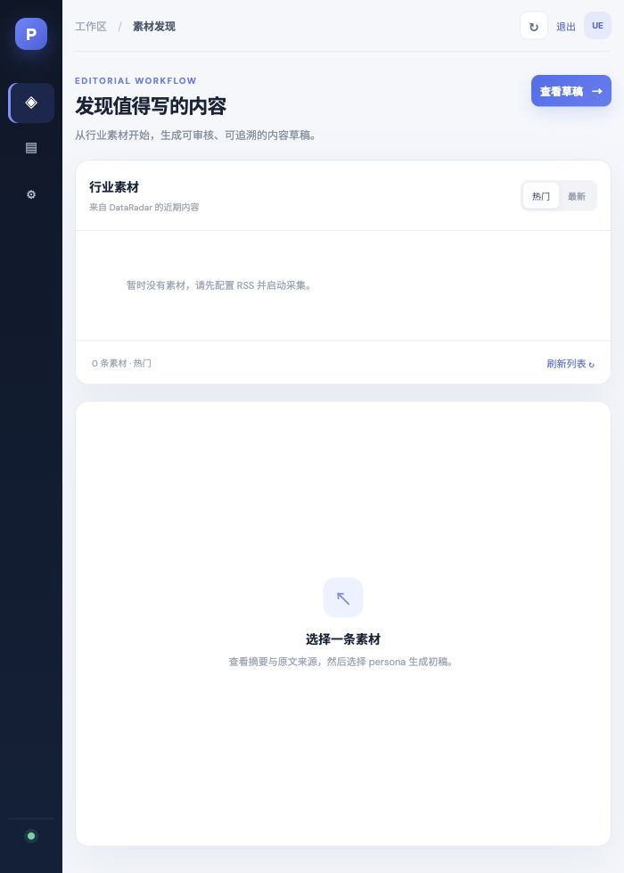
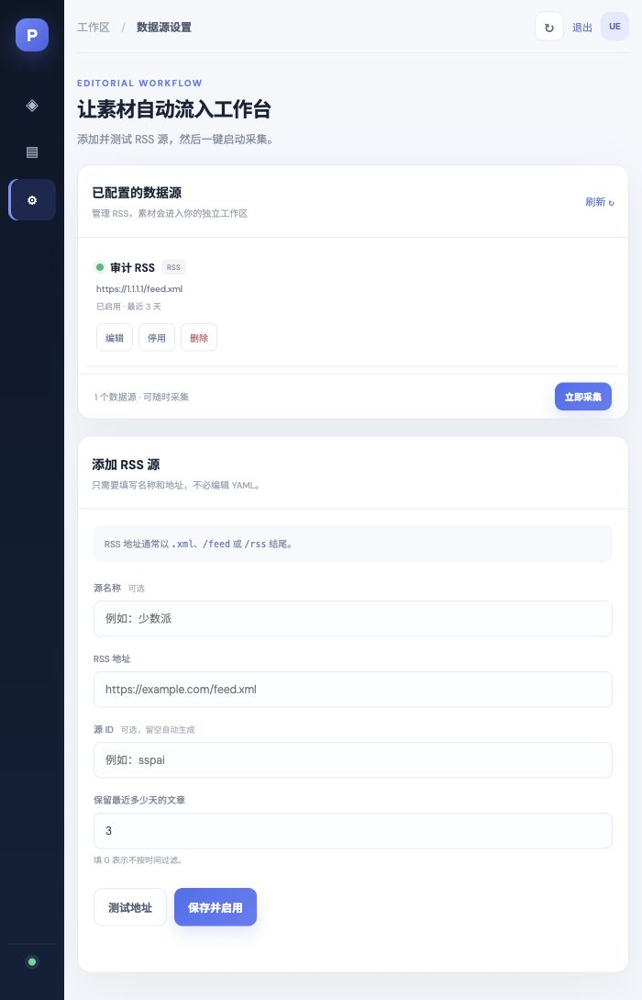
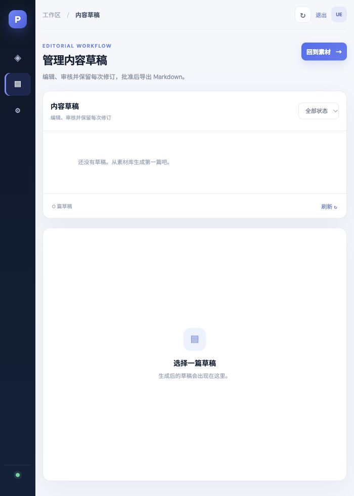

# PostMaker · DataRadar

[](https://www.python.org/)
[](https://fastapi.tiangolo.com/)
[](https://www.postgresql.org/)
[](docs/roadmap.md)

**PostMaker · DataRadar** 是一个面向个人创作者和小型内容团队的内容情报与生产工作台。它从 RSS 和网页中采集公开信息，整理为可搜索素材，再通过可配置的写作 persona 生成草稿，交由人工审核、编辑和导出。

项目把两项职责分开：**DataRadar 负责发现与整理素材，PostMaker 负责生成与审核内容**。你可以只使用 CLI，也可以运行本地审核工作台完成从数据源配置到 Markdown 导出的完整流程。

PostMaker 适合把“每天发现信息、判断选题、生成初稿、人工把关”整理成一条可重复的工作流。它保留原始来源和修订记录，让每次生成都有可追溯的输入、模型和人工决策。

### 系统组成

- **DataRadar**：负责 RSS / 网页采集、正文提取、摘要与标签、重要性评分、SQLite / PostgreSQL 存储，以及素材检索 API。
- **PostMaker**：负责 persona 匹配、提示词构建、内容生成、草稿修订、状态审核和 Markdown / HTML 导出。
- **Web 工作台**：由 React + Vite 构建，嵌入 PostMaker 服务，提供数据源、素材发现和内容草稿三个页面。
- **可选模型层**：通过 LiteLLM 兼容接口调用摘要或生成模型；不配置模型时仍可完成采集、存储、检索和人工编辑。

```text
RSS / RSSHub / 网页 → DataRadar 采集与整理 → 素材检索 → persona 匹配
                                                   ↓
平台发布稿 / Markdown / HTML ← 复制与导出 ← 人工审核 ← PostMaker 生成草稿
```

## 目录

- [功能](#功能)
- [界面预览](#界面预览)
- [快速开始](#快速开始)
- [公开网页部署](#公开网页部署)
- [CLI 示例](#cli-示例)
- [配置概览](#配置概览)
- [完整用户闭环](#完整用户闭环)
- [文档](#文档)
- [项目状态与限制](#项目状态与限制)
- [开发与测试](#开发与测试)
- [安全提示](#安全提示)

## 功能

- **采集与整理**：管理 RSS 源，可选配置 Playwright 网页目标；提取全文并可选生成摘要、分类、标签和重要性评分。
- **素材知识库**：通过 CLI、REST API 和工作台查看、搜索、筛选热门素材；默认使用 SQLite，可配置 PostgreSQL 和 Redis。
- **多人设生成**：用 YAML 定义写作 persona，根据主题兴趣和重要性匹配素材；支持模型生成和可选的二阶段润色。
- **人工审核闭环**：在浏览器中添加、测试和管理 RSS 源，启动采集，选择素材和 persona，编辑草稿、查看修订、批准、归档并导出 Markdown。
- **新手来源与平台适配**：提供 RSSHub 推荐来源，一键启用；已批准草稿可适配微信公众号、知乎、小红书、X / Threads、LinkedIn 和通用 Markdown，复制标题、正文、标签并复用来源图片。
- **本地优先**：不配置模型也能采集和浏览素材；模型只在启用 AI 摘要或生成内容时调用。

## 界面预览

工作台使用统一的深蓝侧边栏、浅色内容画布、圆角面板和蓝色主操作按钮，三个业务页面共享相同的导航、状态提示和空状态组件。下面是通过真实浏览器访问本地 Docker 部署实例得到的页面截图。

| 登录与工作区 | 素材发现 |
| --- | --- |
|  |  |

| 数据源设置 | 内容草稿 |
| --- | --- |
|  |  |

### 页面职责

- **数据源设置**：添加、测试、保存、编辑、启停和删除 RSS；也可以从推荐来源中一键启用 RSSHub；点击“立即采集”启动一次采集任务。
- **素材发现**：在“热门 / 最新”之间切换，查看摘要、标签、重要性和原始来源，并选择 persona 生成草稿。
- **内容草稿**：编辑标题和 Markdown 正文，保存修订，批准、退回审核、归档；批准后按平台生成发布稿并复制标题、正文、标签。
- **登录页**：认证工作区模式下提供注册、登录和退出；工作区数据按账号隔离。

## 快速开始

### 环境

- Python 3.12+
- [uv](https://docs.astral.sh/uv/)
- RSS 采集和 SQLite 模式不要求 Docker；PostgreSQL、Redis、RSSHub 等服务可选。

### 安装依赖

在仓库根目录运行：

```bash
cd DataRadar
uv sync --all-extras

cd ../PostMaker
uv sync --all-extras
```

需要网页采集或浏览器回退全文提取时，再安装 Playwright Chromium：

```bash
cd DataRadar
uv run playwright install chromium
```

### 启动本地工作台

终端一：启动 DataRadar API。首次运行时可从示例文件创建本地配置；SQLite 是默认存储：

```bash
cd DataRadar
cp config/config.example.yaml config/config.yaml
DATARADAR_SQLITE_PATH=./output/dataradar.sqlite3 \
uv run uvicorn api_server.main:app --host 127.0.0.1 --port 8000
```

终端二：启动 PostMaker 工作台：

```bash
cd PostMaker
export DATARADAR_API_BASE="http://127.0.0.1:8000"
export AI_API_KEY="your-api-key"
export AI_MODEL="deepseek/deepseek-chat"
uv run postmaker workbench
```

打开 <http://127.0.0.1:8787>，进入“数据源”添加 RSS，测试并保存后点击“立即采集”；采集完成后到“素材发现”选择素材和 persona，生成草稿，经人工编辑、批准后导出 Markdown。采集与浏览不需要 AI 密钥；只有 AI 摘要或生成步骤需要模型配置。

首次使用的完整步骤、认证工作区配置和故障排查见[中文操作指南](docs/user-guide.md)。

### 公开网页部署

仓库提供了一套面向单机或小规模团队的公开工作台 Compose 配置。它使用 SQLite 为每个注册用户创建独立 workspace，由 PostMaker 提供网页入口，DataRadar 只在内部网络提供 API：

```bash
cp .env.public.example .env
# 编辑 .env，将 WORKSPACE_AUTH_SECRET 换成 openssl rand -hex 32 生成的随机值
docker compose -f docker-compose.public.yml up -d --build
```

浏览器访问 <http://127.0.0.1:8787>，注册后即可按“添加数据源 → 采集 → 浏览素材 → 生成草稿 → 审核 → 导出”操作。停止服务使用 `docker compose -f docker-compose.public.yml down`；数据保存在 `public_data` 卷中。需要 HTTPS 时，应在反向代理中终止 TLS，并将 `POSTMAKER_COOKIE_SECURE=true`。

完整部署说明、环境变量和升级注意事项见[部署指南](docs/deployment.md)。

## CLI 示例

```bash
# DataRadar：采集、检查和查询素材
cd DataRadar
uv run dataradar fetch
uv run dataradar status
uv run dataradar source list
uv run dataradar kb search "大模型" --limit 10
uv run dataradar kb trending --limit 10

# PostMaker：检查 persona、预览匹配并生成草稿
cd ../PostMaker
uv run postmaker personas
uv run postmaker generate --trending --limit 3 --dry-run
uv run postmaker generate --trending --limit 3
```

CLI 的完整选项和网页工作台每个页面的操作步骤见[操作指南](docs/user-guide.md)。

## 完整用户闭环

一次完整的内容生产流程可以按下面的顺序执行：

1. 在“数据源设置”添加 RSS，点击“测试地址”确认源可访问，再点击“保存并启用”。
2. 点击“立即采集”，等待任务完成；DataRadar 会抓取条目、提取全文，并按配置生成摘要、标签和重要性评分。
3. 返回“素材发现”，在“热门”或“最新”列表中选择素材，核对原始来源和摘要。
4. 选择写作 persona，点击“生成审核草稿”。生成结果默认进入“待审核”。
5. 在“内容草稿”编辑标题与正文，查看修订历史；确认事实、来源和格式后点击“批准”。
6. 在“发布准备”选择微信公众号、知乎、小红书、X / Threads、LinkedIn 或通用 Markdown，复制适配后的标题、正文和标签。
7. 如果素材带有来源图片，按配图清单复用；最后在目标平台的官方发布入口完成发布。
8. 对已批准草稿点击“导出 .md”，保存归档文件。

DataRadar 解决“信息从哪里来、如何整理和检索”，PostMaker 解决“如何按写作风格生成、审核和交付”。两者通过 REST API 和 workspace 签名请求连接，工作台只需要暴露 PostMaker 端口。

## 配置概览

| 文件或环境变量 | 用途 |
|---|---|
| `DataRadar/config/config.yaml` | RSS、网页目标、采集和 AI 摘要配置；可从 `config.example.yaml` 复制 |
| `PostMaker/config/config.yaml` | DataRadar 地址、模型和输出配置 |
| `PostMaker/config/personas/` | 写作 persona 定义 |
| `DATARADAR_SQLITE_PATH` | DataRadar 本地 SQLite 文件路径 |
| `DATARADAR_API_BASE` | PostMaker 访问 DataRadar API 的地址 |
| `AI_API_KEY`、`AI_MODEL`、`AI_API_BASE` | 模型凭据、模型名称及可选兼容 API 地址 |
| `POSTMAKER_AUTH_REQUIRED`、`DATARADAR_AUTH_REQUIRED` | 启用工作台登录及 DataRadar workspace 签名校验 |
| `WORKSPACE_AUTH_SECRET` | 两个服务共享的 workspace 签名密钥 |

模型名使用 LiteLLM 格式，例如 `deepseek/deepseek-chat`。密钥应通过环境变量或部署平台的密钥存储提供，不要写入版本控制中的配置文件。

## 文档

- [中文操作指南](docs/user-guide.md)：安装、数据源配置、采集、检索、CLI、工作台审核、备份和排障
- [系统架构](docs/architecture.md) · [REST API 参考](docs/api-reference.md)
- [部署指南](docs/deployment.md) · [persona 指南](docs/persona-guide.md) · [测试指南](docs/testing.md)
- [内容闭环改造计划](docs/2026-content-workflow-plan.md)：RSSHub、新手引导、平台适配和图文导出
- [完整链路审计](docs/full-chain-audit-report.md) · [产品目标](docs/product-goal.md) · [路线图](docs/roadmap.md)

## 项目状态与限制

当前版本是可在本地运行的 **local-first MVP**。工作台支持匿名本地模式，也可以启用账号登录和按用户隔离的 SQLite 工作区。它不会自动向公众号、知乎、小红书等外部平台发布内容。

认证工作区模式适用于 SQLite 单机部署。PostgreSQL 仓储尚未加入 workspace 隔离，采集任务状态保存在 DataRadar 进程内，团队权限和共享任务队列也尚未实现。因此当前版本不是开箱即用的公网多租户 SaaS；公网部署前请阅读[部署指南](docs/deployment.md)和[完整链路审计](docs/full-chain-audit-report.md)。

## 开发与测试

```bash
cd DataRadar
uv run pytest tests/ -q

cd ../PostMaker
uv run pytest tests/ -q -m "not e2e"
```

E2E 测试需要运行中的 DataRadar API、模型配置及额外服务。开发分支和测试流程见[测试指南](docs/testing.md)。

## 安全提示

- 不要把 API key、数据库文件或生成产物提交到 Git。
- 对外部署时启用认证和 HTTPS，设置强随机 `WORKSPACE_AUTH_SECRET`，限制 DataRadar API 的可访问范围，并配置限流。
- RSS 和网页采集会访问外部地址；仅添加你有权访问和处理的公开来源。
